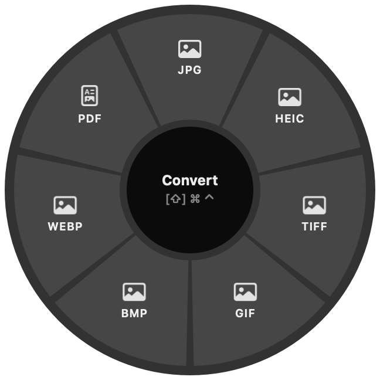

# Swivel

An open-source menu-bar file converter for macOS. Drag a file, tap a key, and a
wheel of options opens around your pointer. Drop the file on a segment and the
result is saved next to the original. Nothing is uploaded, and the app makes no
network requests.

<p align="center"></p>

| While dragging, tap | Wheel |
|---|---|
| ⇧ Shift | **Convert**: formats that fit the file |
| ⌘ Command | **Tools**: compress, strip metadata, rotate, merge, split, … |
| ⌃ Control | **Actions**: AirDrop, Copy, Copy Path, Reveal, Terminal, Move To… |

Tap a different key to switch wheels. Drop on the centre, or anywhere outside
the wheel, to cancel. The menu-bar item also has **Convert Files…** for when you'd
rather pick files than drag them.

## What it converts

| Files | Built in (Apple frameworks) | With `ffmpeg` / `cwebp` installed |
|---|---|---|
| Images: JPG PNG HEIC TIFF GIF BMP WebP | to JPG, PNG, HEIC, TIFF, GIF, BMP, PDF | + WebP output; GIF → MP4 |
| Audio: MP3 M4A WAV AIFF FLAC CAF | to M4A, WAV, AIFF, CAF | + MP3, FLAC, OGG, Opus, and OGG/Opus input |
| Video: MP4 MOV M4V | to MP4, MOV, M4V, M4A | + MKV, WebM, AVI input and output, GIF, MP3, WAV |
| PDF | to PNG/JPG/HEIC/TIFF (one image per page), TXT | |
| Documents: DOCX DOC RTF RTFD ODT HTML TXT Markdown | to DOCX, DOC, RTF, ODT, HTML, TXT, PDF | |
| Tables: CSV TSV | CSV ⇄ TSV | |
| Subtitles: SRT VTT | SRT ⇄ VTT, to TXT | |
| Archives: ZIP TAR TAR.GZ | repack between formats, extract | |

Tools: **Compress** (images, video), **Strip Metadata**, **Half Size**, **Rotate**,
**Make PDF** (several images), **Merge PDFs**, **Split Pages**, **Mute** (video),
**Make GIF** and **Normalize** (need ffmpeg), **Extract** (archives), **Zip** (anything).

Results never overwrite anything: `photo.png` becomes `photo.jpg`, then
`photo 2.jpg`, and so on.

Optional engines:

```bash
brew install ffmpeg webp
```

## Build

You need macOS 13 or later and Swift 5.10 or later (Xcode, or just the Command Line Tools).

```bash
scripts/bundle.sh            # builds build/Swivel.app
cp -R build/Swivel.app /Applications/
open /Applications/Swivel.app
```

Run the tests:

```bash
scripts/test.sh
```

## How it works

- `SwivelCore` is the conversion library. `Catalog` decides what to offer for a
  selection, `Engine` runs it, and `OutputNaming` picks safe file names. It uses
  ImageIO, PDFKit, AVFoundation and TextKit, and runs `ffmpeg`, `cwebp`,
  `ditto` and `tar` as separate processes.
- `Swivel` is the AppKit app. `DragWatcher` notices a mouse-down with a global
  event monitor (no Accessibility permission needed), then polls the modifier
  keys and the system drag pasteboard while the button is held. `WheelPanel`
  is a borderless, non-activating window whose `WheelView` segments are
  ordinary drop targets.

The app is not sandboxed, so it can save results beside files anywhere and run
the command-line engines.

## License

MIT
